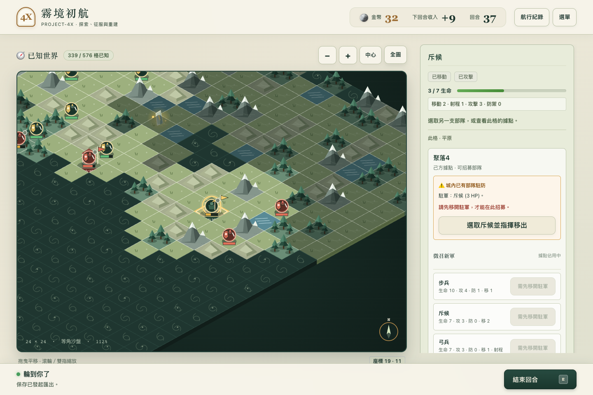
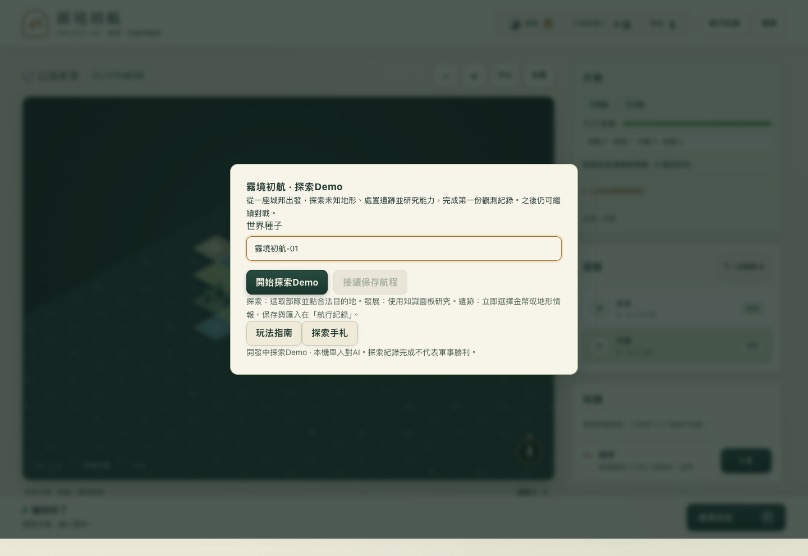
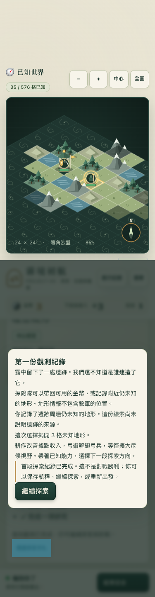

# PROJECT-4X《霧境初航》

在迷霧中帶領一座城邦探索、研究、交戰，並在失去國土後延續文明的原創回合制策略遊戲。

**Demo02：已發布的 Web/PWA 預覽版。Playable Alpha 仍為 PARTIAL。**
目前三兵種、三科技與既有規則可玩；Demo03 新內容另外開發，不覆蓋 Demo02。

[下載 Web Demo](https://github.com/juhjuhx/-PROJECT4X-AI-STUDIO-FRONTEND-20261014./releases/tag/demo02-web-20261024-r3) · [目前狀態](docs/handoff/PROJECT-STATUS.md) · [Roadmap](docs/roadmap/ROADMAP.md) · [文件索引](docs/INDEX.md)

## Demo03 隔離玩法預覽（開發分支）

主創已批准測試數值；盾衛/機動偵察、兩項新研究與版本化內容包已有真實可玩閉環。這不是正式平衡或Alpha完成，城市/新地形/新版遺跡仍待後續裁決。

本分支建置啟動後開啟 `http://127.0.0.1:4173/?preview=demo03`，或主選單選「試玩Demo03隔離玩法預覽」。預設G1入口及Demo02下載不變；預覽與G1使用不同本機保存槽。Save2/Replay2不支援降版到Demo02，舊G1存檔仍可用原規則續玩。

[數值/版本決策](docs/product/DEMO03-GAMEPLAY-DECISIONS.md) · [254測試/真桌機手機旅程](docs/verification/DEMO03-PREVIEW/TASK5-RESULTS.json) · [預覽畫面](docs/verification/DEMO03-PREVIEW/screenshots/desktop-preview.png)

## 遊玩

到 Releases 下載 Demo02 的 Web r3 ZIP，解壓後 macOS 雙擊「啟動Demo.command」，在瀏覽器開啟 http://127.0.0.1:4173 。

也可在解壓資料夾執行：

    node scripts/serve.mjs

需要 Node.js；本輪在 Node 26.10.0 實測。已建置 Web 包不用 npm 安裝，不含 Node 或 APK。不使用 file:// 直接開 index.html。Ctrl+C 關閉自己的服務；若4173被其他程式使用，可執行 PROJECT4X_PORT=4174 node scripts/serve.mjs。

選「開始探索Demo」→選斥候→向合法未知格移動→處置遺跡→研究科技→閱讀探索手札。三項觀測完成即留下第一份紀錄，仍可繼續探索與對戰，**不是軍事勝利**。

圖片為真 Chromium 執行；手機375×812是模擬touch，非真機。完整viewport/圖片尺寸與SHA見 screenshots/SCREENSHOTS.json。

## 世界與風格

世界的文明不共享單一科技時代，也可能有不同生存需求與感知方式。弱者可以透過有代價的研究、地形、器物與跨文明互動尋找翻盤機會；亡國不代表文明消亡。世界具有唯一可逐步揭露的起源，但本Demo沒有提前公布真相。

上述是已確認的長期方向，不代表代謝、外交、文化、轉型、星際或完整非對稱文明已實作。文明名稱與「織機／書寫者／場結晶」細節仍是提案。正式來源：[World Bible](docs/game-design/WORLD-BIBLE.md)、[文明系統](docs/game-design/CIVILIZATION-SYSTEMS.md)、[CCTS](docs/game-design/CCTS-SPEC.md)、[決策簿](docs/game-design/DECISION-REGISTER.md)。

美術沿用 Mistbound Diorama：70% grounded low-poly miniature、20% atmospheric hand-painted、10% restrained cinematic motion。這是方向，不是渲染比例。現為 Canvas2D 等角程序微縮地圖；完整兵模、文明建築與Demo03視覺仍在發展。沒有複製 Polytopia 素材或介面。

## 已實作玩法

- 24×24 seed 地圖、plain/forest/hill/mountain/water、動態迷霧與合法情報。
- 步兵、斥候、弓兵；移動、攻擊、佔領、空城招募、新兵下一己回合行動。
- 耕作、弓術、尋徑；金幣收入、研究與招募取捨。
- 遺跡金幣／最多實際剩餘3格地形情報，不含敵軍位置。
- 政治中心、流亡與異地重建；U或S仍存在即可續玩，兩者皆零才淘汰。
- 主選單、探索手札、獨立觀測完成狀態、AI回合、Save/Load與Replay驗證。

目前遺跡仍採G1「看見即取得」舊行為；主創新裁決是「發現與實際抵達取得分離」，尚待獨立ruleset遷移。不能用新文案假裝完成。

## 操作與保存

選取部隊／據點後，使用合法目的地或操作清單；攻擊不自動進城，需保留可進入並佔領的單位。先移開己方據點駐軍才能招募。N選下一部隊、E結束回合，地圖可用滑鼠、鍵盤與touch；手機採指揮分頁。

「航行紀錄」可保存、載入、匯出、匯入與驗證Replay。同Browser、同網址/port共用本機槽位；清除網站資料會丟進度，請匯出備份。探索手札sidecar僅存本機，不隨外部save/replay檔匯出。

完整Save/Replay包含世界真相，**不應作為Fog安全的玩家公開回放**。Import先驗後替換；失敗不得破壞現局。沒有雲同步或線上多人。

## PWA

先連線完整開啟一次，再使用Browser提供的「安裝」或加入主畫面。公開網站需HTTPS，本機loopback用於測試。靜態程式、圖示與manifest可離線，存檔不進service-worker cache。

新版本會等待舊遊戲頁面關閉才啟用；先保存再關閉，不強制中斷進行中遊戲，也不要清空網站資料來更新。已驗本機Chromium安裝條件、離線與更新等待；實體手機安裝及公開HTTPS部署未驗收。GitHub Release不等於已部署線上網站。

## 開發與一鍵驗證

    npm ci --ignore-scripts
    npm run check
    npm test
    npm run build
    npm start

第一次開發環境需另備Playwright Chromium：

    npx --no-install playwright install chromium
    node scripts/verify-demo02.mjs

驗證器依序跑公開資料檢查、types、tests、build及真Browser/Gameplay/Demo/PWA/更新等待，自建並關閉本機服務。詳細收據留在來源樹外的私有暫存／PROJECT4X_EVIDENCE_DIR；公開stdout只有安全摘要與hash。Chromium可用PROJECT4X_CHROMIUM_PATH指定已安裝執行檔，**不是只檢查畫面有render**。

這是Demo02工程入口；原 npm run verify 的 Full100 門檻保持獨立，不把它改成Demo通過。基線203 tests保留，發布工具新增測試的數量與原因見 RELEASE-STATUS。

## 限制與計畫

真人完整體驗、實體手機、45–90分鐘、完整無障礙、正式美術與Android APK尚未驗收。歷史R5 Full100是87 COMPLETE／13 TURN_LIMIT，T3/T6 FAIL保留；現行E策略未重跑Full100，AI長局仍可能僵持。探索Demo不需要等待AI消滅所有對手，但不假造winner。

Demo03：盾衛、機動偵察、科技分支、簡化城市成長與新地圖互動均須依決策簿分段實作；未批准數值只可隔離實驗。詳[內容提案](docs/product/CONTENT-EXTENSION-PROPOSAL.md)、[任務Ledger](docs/handoff/MASTER-TODO.md)、[路線](docs/roadmap/ROADMAP.md)。

## 技術、授權與貢獻

TypeScript、Vite、原生DOM、Canvas2D；唯一GameState/applyCommand，UI走GameplayPort，AI只用Observation。沒有第二套引擎或必要AI模型API。

原創程式/文件/圖示採MIT；Vite生成helper與工程文件工具的告知見[LICENSE](LICENSE)、[第三方告知](THIRD-PARTY-NOTICES.md)、[依賴清單](docs/research/DEPENDENCY-INVENTORY.md)。PixiJS/Phaser/boardgame.io等研究候選不等於已整合。

開發請先讀[AGENTS](AGENTS.md)、[Contributing](CONTRIBUTING.md)、[文件索引](docs/INDEX.md)。歷史QA公開副本已去識別，原始receipt hash代表本機保留原件；投影對照見 docs/verification/PUBLICATION-PROVENANCE.json，不能拿舊結果冒稱當前CI通過。
