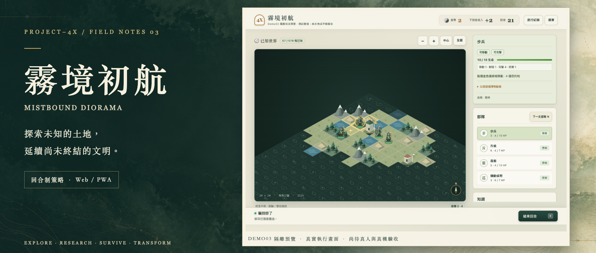
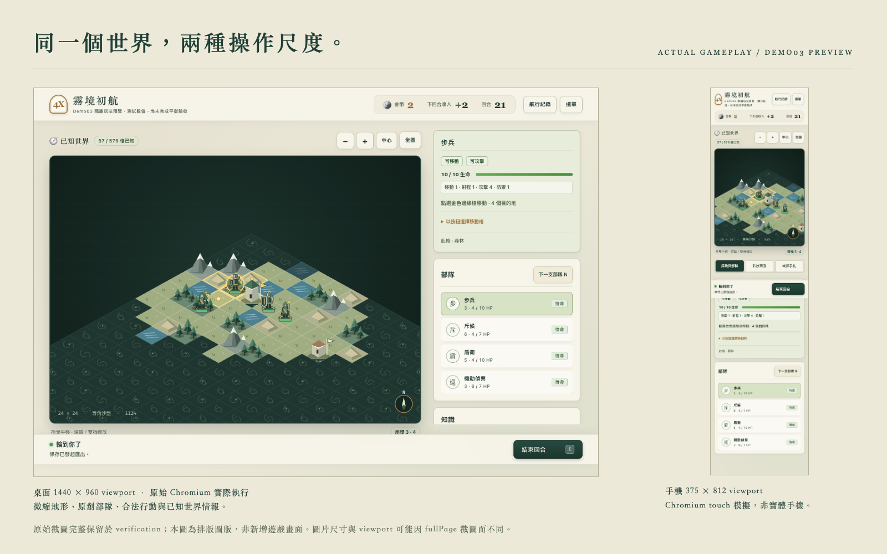

<p align="center">
  
</p>

# PROJECT-4X《霧境初航》

**一款關於探索、抉擇與文明延續的原創回合制 4X 策略遊戲。**

從迷霧中的小城邦出發，安排部隊、研究技術、調度有限資源，逐步理解世界。失去國土之後，文明的故事仍可能繼續。

[下載已發布的 Demo02](https://github.com/juhjuhx/-PROJECT4X-AI-STUDIO-FRONTEND-20261014./releases/tag/demo02-web-20261024-r3) · [Demo03 預覽 / Draft PR #4](https://github.com/juhjuhx/-PROJECT4X-AI-STUDIO-FRONTEND-20261014./pull/4) · [試玩與回饋](docs/verification/DEMO03-PREVIEW/D03-009-PLAYTEST.md) · [文件索引](docs/INDEX.md)

## 現在可以玩哪一版？

| 版本 | 可以取得什麼 | 真實狀態 |
|---|---|---|
| **Demo02 Web / PWA** | Releases 的 Web r3 ZIP；三兵種、三科技、探索手札與既有規則 | 已發布；使用 `g1-ccts-1`、Save1 / Replay1 |
| **Demo03 視覺增量** | 微縮兵模、地形、主選單、手機介面；PR #3 已合併 main | 已實作及工程驗證；不回頭改寫 Demo02 下載包 |
| **Demo03 隔離玩法預覽** | 本分支的盾衛、機動偵察、兩項新研究與版本化內容 | 工程驗證通過，**Draft PR #4，尚未正式發布或合併 main** |

**Playable Alpha 仍為 PARTIAL。** 真人體驗、實體手機、正式平衡與新規則 Full100 尚未驗收。CI 成功表示工程檢查通過，不能代替這些產品 Gate。唯一人工驗收紀錄在 [D03-009 試玩表](docs/verification/DEMO03-PREVIEW/D03-009-PLAYTEST.md)。

本頁對應 `experiment/demo03-gameplay-preview`；GitHub 預設 main 與舊 Release 的內容可能不同。最新提交與 CI 請看 [PR #4](https://github.com/juhjuhx/-PROJECT4X-AI-STUDIO-FRONTEND-20261014./pull/4)，不要將本頁介紹的預覽新兵當成 Demo02 已有內容。

## 看得見的世界，玩得到的選擇



桌面 viewport 為 1440 × 960，手機為 375 × 812；皆為真 Chromium 執行，手機採 touch 模擬，**不是實體手機驗收**。fullPage 圖片高度可以超過 viewport。[原始桌面](docs/verification/DEMO03-PREVIEW/screenshots/desktop-preview.png)、[原始手機](docs/verification/DEMO03-PREVIEW/screenshots/phone-preview.png)完整保留。Banner 是真實畫面加標題、AI 生成裝飾背景的宣傳排版；沒有用概念圖冒充 UI。[圖片來源、SHA 與製作說明](docs/media/readme/ASSET-MANIFEST.json)。

一段目前可以完成的旅程：

1. **探索。** 選斥候向合法未知方向移動，辨識地形、據點與迷霧邊界。
2. **取捨。** 將金幣投入研究，或移開城中駐軍、招募下一回合才能行動的新兵。
3. **交戰。** 攻擊守軍、保留可入城者，再移入並佔領；攻擊不會自動替你完成 Capture。
4. **留下紀錄。** 處置遺跡、閱讀探索手札，保存、重新載入，或驗證 Replay 後繼續遊玩。

探索 Demo 的手札觀測完成是一段體驗的里程碑，**與軍事勝者分開**。遊戲不會為了結束 Demo 而合成 winner。

| 系統 | 當前可玩內容 | 邊界 |
|---|---|---|
| 世界與情報 | 24 × 24 seed 地圖；平原、森林、丘陵、山岳、水域；迷霧與合法可見資訊 | 沒有將隱藏敵軍位置交給 HUD 或 AI |
| 戰鬥與城市 | 移動、攻擊、佔領、空城招募、回合交接 | 城市等級、建築投資與人口成長尚未實作 |
| 經濟與研究 | 金幣收入、招募與研究成本；既有耕作、弓術、尋徑 | 沒有完整多資源／交易經濟 |
| 遺跡與敘事 | 金幣或最多實際剩餘三格地形情報；探索手札 | 現行仍為 G1「看見即取得」；發現／抵達取得分離待新版遷移 |
| 文明延續 | 政治中心、流亡與異地重建；單位或據點仍存在即可續玩 | 改革、革命、文化、外交與文明融合仍屬後續系統 |
| 資料與操作 | 本機 Save / Load、檔案匯入匯出、Replay；桌面與手機分頁 | 沒有雲端同步、線上多人或必要的 AI 模型 API |

### Demo03 新玩法：先做可驗證的策略分歧

隔離預覽新增兩種用途不同的單位，配套研究、合法 Action、AI、介面、Save / Replay 都已有實作。

| 單位／研究 | 預覽測試基準 | 玩家面對的取捨 |
|---|---|---|
| 盾衛 `shieldGuard` | 招募 6；HP 10／攻 3／防 2／移 1；防禦工程研究 7 解鎖 | 較高成本與較低攻擊，換取守備能力；沒有未實作的護衛光環 |
| 機動偵察 `mobileScout` | 招募 7；HP 7／攻 3／防 0／移 3；尋徑後研究軍事機動 6 解鎖 | 更多研究與招募投入，換取機動；仍受地形、友軍佔位限制 |

數值僅獲批准作 **D03-PREVIEW-001 隔離試玩基準**，不等於正式平衡。步兵、斥候、弓兵與原三科技的 G1 行為保留。新局專用 `demo03-preview-1` 綁定固定內容摘要，使用 Save2 / Replay2；載入舊 G1 存檔會繼續原規則，沒有原地改寫舊局。[完整數值、版本取捨與驗收](docs/product/DEMO03-GAMEPLAY-DECISIONS.md)。

## 我們想做的遊戲

**探索世界，也探索「文明可以成為什麼」。** 這個世界不以同一條科技年代線定義所有文明。不同文明可以具有不同的生存條件、技術、力量來源與感知方式；同一片土地，可能呈現截然不同的世界表象。局域物理與外域能量可以並存，但荒誕仍須遵守內部因果。

**文明延續比領土版圖更長。** 政治控制、文化影響與文明身份是不同層次。亡國不必等於故事結束：收復舊都、異地建國、轉型、分裂或融合，都是已確認的長期方向；現行核心先以流亡與重建驗證其中最小的一部分。`U > 0 OR S > 0` 可以續玩，`U = 0 AND S = 0` 才淘汰，沒有額外流亡倒數。

**強弱差距可以很大，翻盤必須有代價。** 地形、研究、稀有器物、外文明協助與交易，將來可以提供不同的生存路徑。它們是設計方向，不能由目前三／五種兵種推論為已完成的非對稱文明系統。

**世界有可逐步揭露的唯一真相。** 未知文明、遺跡與矛盾線索應推動探索；首頁與 Demo 不提前揭曉起源答案。長期從地表走向更大尺度時，原有世界也應繼續運行。星際階段、完整事件鏈與世界真相系統目前尚未實作。

這些主創方向以 [World Bible](docs/game-design/WORLD-BIBLE.md)、[文明系統](docs/game-design/CIVILIZATION-SYSTEMS.md)、[CCTS](docs/game-design/CCTS-SPEC.md) 與 [Decision Register](docs/game-design/DECISION-REGISTER.md) 為來源。**USER_CONFIRMED 設計意圖、PROPOSED 內容與 IMPLEMENTED / TESTED_PASS 實作證據分開記錄**，新敘事不會自動成為 Canon。

### 視覺：Mistbound Diorama

微縮世界、手繪氣氛與克制的動態回饋：70% grounded low-poly miniature、20% atmospheric hand-painted、10% cinematic motion。這是美術優先級，並非物理渲染比例。

目前採 **Canvas2D 等角 2.5D 地圖、原創程序兵模與地形**，搭配羊皮紙色介面、森林綠與金色導航。桌面保留世界視野，手機使用分頁指揮面板。以清楚傳遞合法情報與操作回饋為前提，再逐步深化文明建築、單位輪廓與事件演出。現有素材沒有直接複製 Polytopia 的專有美術或介面；[視覺交接](docs/art/DEMO03-VISUAL-HANDOFF.md)、[Design Tokens](docs/art/DESIGN-TOKENS.md) 與 [素材登錄](docs/art/ASSET-REGISTRY.json) 可供下一位呈現設計者接手。

## 如何遊玩

### 下載 Demo02

從 [Demo02 Release](https://github.com/juhjuhx/-PROJECT4X-AI-STUDIO-FRONTEND-20261014./releases/tag/demo02-web-20261024-r3) 下載 Web r3 ZIP 並解壓。需先安裝 Node.js；已建置 ZIP 不需安裝 npm 依賴，也不包含 Node 或 APK。macOS 可雙擊 `啟動Demo.command`，或在解壓目錄執行：

```sh
node scripts/serve.mjs
```

開啟 `http://127.0.0.1:4173`；請勿以 `file://` 直接開啟 `index.html`。若 port 已被使用：

```sh
PROJECT4X_PORT=4174 node scripts/serve.mjs
```

以 `Ctrl+C` 關閉自己啟動的服務。macOS 系統安全提示及實體裝置啟動仍須依當前環境驗證，不宣稱所有裝置皆已實測。

### 從原始碼試玩 Demo03 預覽

```sh
git clone --branch experiment/demo03-gameplay-preview https://github.com/juhjuhx/-PROJECT4X-AI-STUDIO-FRONTEND-20261014..git project4x
cd project4x
npm ci --ignore-scripts
npm run build
PROJECT4X_PORT=4174 npm start
```

開啟 **`http://127.0.0.1:4174/?preview=demo03`**。使用獨立測試 profile / port，避免與既有 Demo02 網站資料混用。這不是已部署的公開試玩網址；手機上的 `127.0.0.1` 也不會連到你的電腦。受控 HTTPS 試玩地址與實體手機驗收前置見 [D03-009](docs/verification/DEMO03-PREVIEW/D03-009-PLAYTEST.md)。本工程已在 Node 26.10.0 驗證；版本以 lockfile 與 CI 為準。

### 操作與保存

- 點選部隊／據點，再選合法目的地或操作清單。`N` 選下一部隊，`E` 結束回合；地圖支援拖曳、滾輪與雙指縮放，手機採指揮分頁。
- 招募前先移開己方據點的駐軍；新兵到下一個己方回合才能使用。攻擊後若要佔領，仍須合法移入據點。
- 「航行紀錄」可本機保存、載入、匯出、匯入與驗證 Replay。預覽和 G1 使用不同保存槽，**Save2 / Replay2 不支援降版到 Demo02**。
- 同瀏覽器、同網址／port 的網站資料會共用本機儲存；清除網站資料會失去進度。請先匯出備份。探索手札 sidecar 僅保存在本機，不隨外部 Save / Replay 匯出。
- 完整 Save / Replay 包含世界真相，適合本機驗證，**不是可公開分享的 Fog-safe 玩家回放**。原始檔與含隱藏情報 trace 請留在私人證據區。

### PWA 與離線

連線完整開啟一次，再依瀏覽器提供的安裝／加入主畫面流程操作。靜態程式與必要圖示可離線；存檔不進 Service Worker cache。新版本會等待舊遊戲頁面關閉才啟用，先保存再關閉，不以清除網站資料作為更新方式。

本機 Chromium 的離線與等待更新已有工程測試；公開 HTTPS 部署、iOS / Android 實機安裝與更新仍未驗收。GitHub Release 是下載交付，不等於已上線的 PWA 網站。

## 為什麼這樣建置

TypeScript + Vite + Native DOM + Canvas2D，讓同一套策略核心支援桌面與手機呈現。遊戲執行不依賴模型 API，也不另外建立一套 Android 規則引擎。

```text
玩家 UI ──合法 Action──> GameplayPort ──> GameSession
    ↑                                      │ 唯一狀態所有權
    └── Observation / 安全事件 <── applyCommand / GameState
                  │
                  └──> AI（只讀 Observation）──> 合法 Action

本機檔案 UI ──> LocalPersistencePort ──> 先驗證、後替換 / Save / Replay
```

- **一個規則來源。** 唯一 `applyCommand` 處理合法命令；畫面與 AI 不自行實作 reducer。
- **情報有邊界。** UI 與 AI 使用合法 Observation，HUD 不取得全知世界或私有歷史。
- **交易可追蹤。** `requestId` 去重、`expectedVersion`、`generation` 與 AI 取消保護局面；重送不重複扣款或播放事件，失敗 Import 不破壞現局。
- **內容逐片擴充。** 現為固定兩套版本化內容包及白名單效果；穩定 ID、依賴與摘要支撐 Save / Replay。尚未宣稱任意外部內容包皆可直接載入。
- **先驗證閉環。** 新單位需要研究、付費、招募、行動、AI、真 UI 與保存回放一起成立；新規則另立決策與相容策略，不以新增按鈕代替玩法。

接口與所有權：[Frontend-Core Contract](docs/contracts/FRONTEND-CORE-CONTRACT.md) · [Module Ownership](docs/contracts/MODULE-OWNERSHIP.md) · [Save / Replay](docs/architecture/SAVE-REPLAY-CONTRACT.md)。

### 找檔案與恢復工作

```text
README.md → AGENTS.md → docs/handoff/PROJECT-STATUS.md
                          → MASTER-TODO.md → NEXT-ACTION.md
src/
├── core/          規則、版本化內容、AI、持久化
├── session/       唯一狀態所有權、交易、AI 排程與 ports
├── presentation/  actor-scoped 安全事件
├── ui/            地圖、微縮兵模、視覺登錄、預覽入口
├── demo/          選單、探索手札與本機進度
└── main.ts        composition root
public/            運行時素材、圖示與 PWA manifest
tests/             核心／契約／相容性／QA 工具測試
scripts/           建置、服務與驗證入口
docs/              規則、世界、接口、任務與安全驗證摘要
history/           原始設計選集；不取代當前決策
experiments/       隔離研究；不視為正式 AI
```

[完整文件索引](docs/INDEX.md) 是跨上下文入口；[工作區整理說明](docs/handoff/WORKSPACE-INVENTORY.md) 記錄本機管理方式。原始 worktree / 私人證據不隨意搬動，不將整個本機歸檔根上傳 GitHub。

## 驗證、限制與下一步

目前預覽工程基線為 **257 項測試**，包含歷史保護、新內容、雙版本保存與 QA 收據契約；真瀏覽器旅程涵蓋既有 11 個 Browser、12 個 Gameplay、探索 Demo / PWA、兩種 viewport 的預覽與跨版本匯入。Gameplay 玩家指令上限維持 **220**。原始證據、來源摘要與限制見 [TASK5-RESULTS](docs/verification/DEMO03-PREVIEW/TASK5-RESULTS.json)、[CI-VERIFICATION](docs/verification/DEMO03-PREVIEW/CI-VERIFICATION.json) 及 PR 的即時 CI。

重新執行工程驗證：

```sh
npm run check
npm test
npm run build
npx --no-install playwright install chromium
PROJECT4X_PREVIEW_QA=1 node scripts/verify-demo02.mjs
```

驗證器啟動並清理自己的服務／Browser；原始證據留於來源樹外。已有 Chromium 可用 `PROJECT4X_CHROMIUM_PATH` 指定。這個入口驗證 Demo 工程，原 `npm run verify` 的 Full100 門檻保持獨立。

| Gate | 目前如何解讀 |
|---|---|
| 工程／契約／Fog／版本相容性 | 已有 TESTED_PASS 證據；新提交仍看對應 CI |
| 真人與實體手機 | UNVERIFIED；目前人工回饋 0 份，不能用 touch 模擬代答 |
| 正式平衡、45–90 分鐘、完整無障礙 | UNVERIFIED；45–90 分鐘是長期目標 |
| AI 完整對戰 | 歷史 R5 為 87 COMPLETE / 13 TURN_LIMIT，T3 / T6 FAIL 保留；不能當成現行預覽完成率 |
| Demo03 新規則 Full100 / T3 / T6 | UNVERIFIED；長局仍可能僵持 |
| 公開預覽 HTTPS、實機 PWA、Android APK | 尚未完成交付／驗收 |
| Playable Alpha | PARTIAL |

```text
Demo02 已發布 ──> Demo03 視覺已合併 ──> 兩兵／兩科技隔離預覽
                                              │ 現在
                                    真人／真機／平衡／GPT-6 新 diff 審查
                                              ↓
                                      獨立 Release Candidate
                                              ↓ 後續裁決
                           城市最小循環／新地形／遺跡規則遷移
                                              ↓ 長期方向
                          非對稱文明／文化外交／文明轉型／世界真相
```

任務依賴與下一步只在 [MASTER-TODO](docs/handoff/MASTER-TODO.md)、[NEXT-ACTION](docs/handoff/NEXT-ACTION.md) 維護；[Roadmap](docs/roadmap/ROADMAP.md)、[內容擴充提案](docs/product/CONTENT-EXTENSION-PROPOSAL.md) 提供設計脈絡。城市成長、新地形、遺跡新規則均未實作，不把路線圖當交付。

## 參與、授權與來源

請先讀 [AGENTS](AGENTS.md)、[Contributing](CONTRIBUTING.md) 與 [文件權威](docs/game-design/DOCUMENT-AUTHORITY.md)。PR #4 仍維持 Draft，新 diff 待 GPT-6 獨立審查；不因文件美化而跳過產品 Gate 或合併 main。

原創程式、文件與本專案素材採 [MIT](LICENSE)；第三方與製作來源分別見 [THIRD-PARTY-NOTICES](THIRD-PARTY-NOTICES.md)、[依賴清單](docs/research/DEPENDENCY-INVENTORY.md)、[Asset Registry](docs/art/ASSET-REGISTRY.json) 和 [README 圖像 Manifest](docs/media/readme/ASSET-MANIFEST.json)。PixiJS、Phaser、boardgame.io 等研究候選並不等於已整合。Addy Osmani 技能是工程文件工具，不是遊戲運行依賴。

歷史驗證的公開副本經過去識別；[PUBLICATION-PROVENANCE](docs/verification/PUBLICATION-PROVENANCE.json) 區分原始收據與公開文件 SHA。保留歷史 FAIL、私人原件與版本沿革，讓下一位 Agent 能依 source 與證據接續工作。
