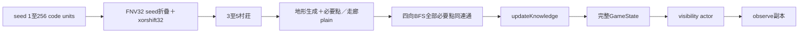
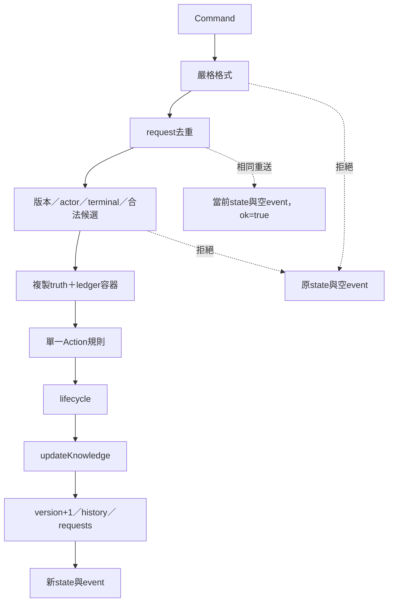
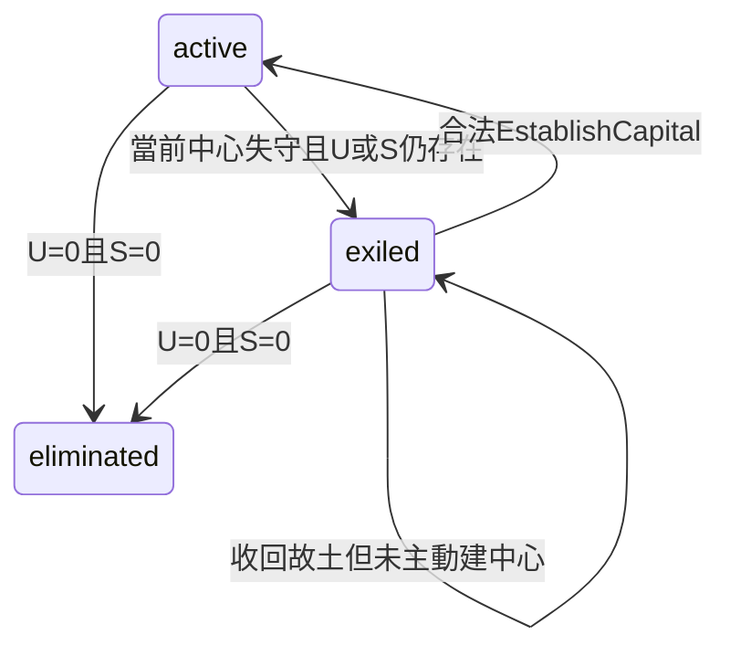
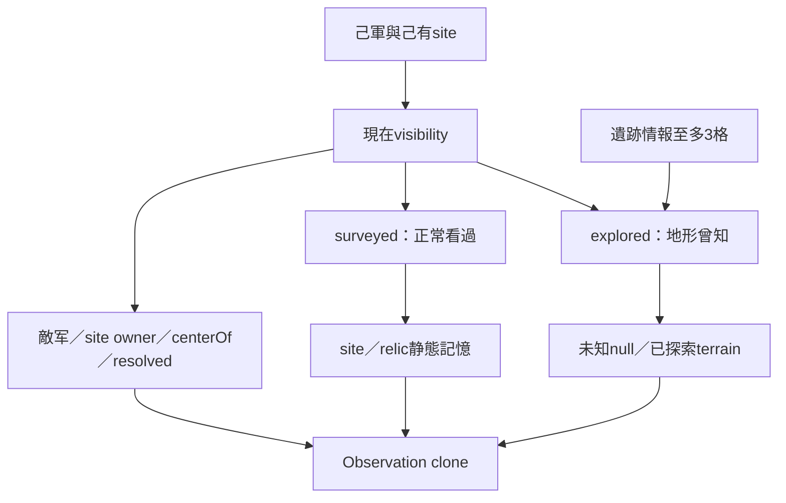

# 資料流與狀態轉換

## 2026-10-17 C2 現行邊界

GameSession 現在獨占 canonical GameState，唯一 reducer 仍 src/core/game.ts:applyCommand。main 為 composition root，只保留 UI view cache／selection，透過 GameplayPort 提意圖；檔案 controls 另取 LocalPersistencePort。session/ai-driver 只收 actor1 Observation，presentation/events 只讀 actor0 前後 Observation 及合法 own receipt，UI/map 只收凍結的可見資料。load 先 core 完整驗證再 replace，Save/Replay 不交 HUD。正式 runtime API、模組與證據見 [FRONTEND-CORE-CONTRACT](../contracts/FRONTEND-CORE-CONTRACT.md) 和 [C2-IMPLEMENTATION-STATUS](../handoff/C2-IMPLEMENTATION-STATUS.md)。以下為原封存架構與 source 行號，凡提 main 持 state／driver 者皆屬 C2 前歷史。

本文件記錄實際控制流。來源範圍：四個core檔案；main/map僅核對核心呼叫點，前端行為由root整合。

## 生成到觀測

RNG只在createGame使用；之後戰鬥與遺跡情報排序没有隨機抽樣。先取一次random決定村莊數，再每次取576個地形樣本，最多65次（attempt0–64）。attempt64降級為全通行forest/hill/plain；必要點及安全走廊覆蓋為plain。全連通確認不受當下單位占位限制，只要求地形連通。`game.ts:29–84`。

updateKnowledge對雙方計算目前visibility，將seen OR進 explored／surveyed；若已有pending或winner就停止遺跡授權。否則僅active首次可見的未claimed遺跡取得權利；取relics陣列第一個。多個同時可見遺跡逐次必答，Resolve後再次updateKnowledge可立即啟動下一個。`game.ts:97–107`。每個actor的被動視野記憶可在對手命令後更新；遺跡認領仍只在己方active階段。

## 命令提交

來源：`game.ts:205–274`。lifecycle先於knowledge，避免已淘汰後才領新遺跡。version與ledger在規則／生命／知識完成後一次發布，UI不会看到「先勝利後流亡」的中間狀態。

## 回合帳務

EndTurn的命令actor是離場方。該方completedTurns+1→active換方→全局turn+1→進場方ownTurns+1。進場方ownTurns>1才收入；所有己有site每個2，farm另+1。只重設進場方單位moved/acted及己有site.recruited，不重設離場方。來源：`game.ts:257–265`。

保存語意不變量：`ownTurns[a] = completedTurns[a] + (active===a ? 1 : 0)`；`turn=1+completedTurns[0]+completedTurns[1]`；actor0 active時兩方completed相同，actor1 active時actor0多1。`persistence.ts:51,59`。此turn是每次交接的半回合序號，不是兩方各走一輪的完整round。

## CCTS與中心

每次成功命令重算兩方。`life`不是按時間推進：有任何己軍或己有site即survives；survives且center有效才active，否則exiled/center=null。零U且零S才eliminated，winner=對方。來源：`game.ts:189–196`。

Capture寫入被占site.owner=actor，heldSince=對方completedTurns。EstablishCapital合法性比較對方completedTurns>heldSince，要求至少一次完整敵方EndTurn已完成。失去再拿回site會重新写heldSince。新中心不重寫originalCapitalId／identityId／lineageId、不發收入、不重設unit或招募。来源：`game.ts:140–142,236–240,256`。

## 視野／情報

情報排序為未explored格對遺跡的曼哈頓距離→y→x，slice(0,3)。它不必連續，也不避開water／mountain，因為獎勵是未知地形知識。正常視野不受地形遮挡，視野公式為菱形距離≤radius。`game.ts:87–111,149–164,249–253`。

## AI與驅動

main建立actor1 Observation→chooseAction(view)→以view.version送applyCommand→成功才取新Observation與畫面；空合法候選停下。headless同樣把所有Action經權威核心。AI沒有直接修改GameState，也沒有seed reconstruction。

AI優先序：遺跡必答→建中心→Capture→進空敵據點→適合Attack→Research→Recruit→Move→EndTurn。移動圖把unknown地形視作可能通行，這只影響意圖；實際候選由核心裁決，不能移入不可通行格。blocked圖排除其他已觀測單位，避免友軍路徑震盪。四角巡查不保證覆蓋所有地圖，見CORE-REVIEW。來源：`ai.ts:10–152`。

## 保存／重播

主程式把完整state JSON送本機儲存或下載。載入text→JSON.parse→validateState→從seed重建初始世界→逐筆歷史Command→全量比對snapshot。只有回傳成功後外層可replace。replay省略snapshot，改為同版本seed+commands重建後比對gameplay hash。詳細schema與拒絕条件見 [SAVE-REPLAY-CONTRACT](SAVE-REPLAY-CONTRACT.md)。

沒有事件溯源資料庫、遠端telemetry或跨裝置同步。history是成功命令，不含被拒絕命令；events只是一個成功文案，不是可重播的細粒度事件stream。
