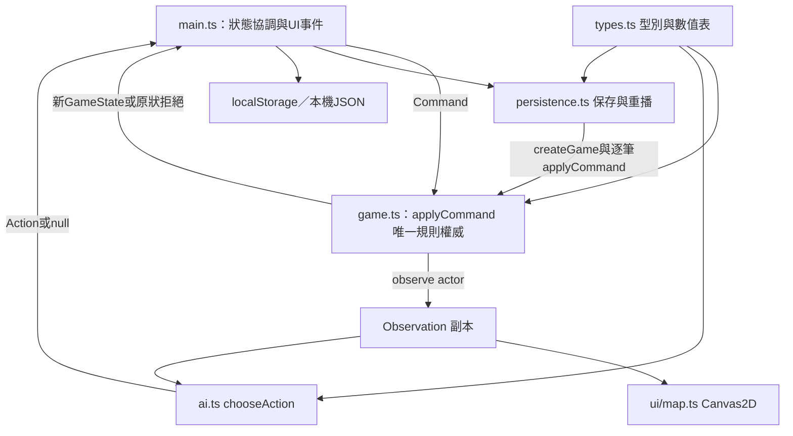

# 系統架構：霧境初航 0.1.0

## 2026-10-17 C2 現行邊界

GameSession 現在獨占 canonical GameState，唯一 reducer 仍 src/core/game.ts:applyCommand。main 為 composition root，只保留 UI view cache／selection，透過 GameplayPort 提意圖；檔案 controls 另取 LocalPersistencePort。session/ai-driver 只收 actor1 Observation，presentation/events 只讀 actor0 前後 Observation 及合法 own receipt，UI/map 只收凍結的可見資料。load 先 core 完整驗證再 replace，Save/Replay 不交 HUD。正式 runtime API、模組與證據見 [FRONTEND-CORE-CONTRACT](../contracts/FRONTEND-CORE-CONTRACT.md) 和 [C2-IMPLEMENTATION-STATUS](../handoff/C2-IMPLEMENTATION-STATUS.md)。以下為原封存架構與 source 行號，凡提 main 持 state／driver 者皆屬 C2 前歷史。

本文件盤點封存來源，沒有變更產品。核心來源為 `src/core/{types,game,ai,persistence}.ts`；完整具名測試映射見 [FEATURE-MATRIX](../handoff/FEATURE-MATRIX.md)。文件中的 IMPLEMENTED 是源碼落地狀態；執行證據與真人可玩性分別見 [IMPLEMENTATION-STATUS](../handoff/IMPLEMENTATION-STATUS.md)。

## 權威與依賴

`game.ts` 不匯入 UI、瀏覽器儲存、AI 或計時器。`types.ts` 只提供資料型別與 UNIT_STATS／TECH_STATS；AI 只匯入 types 並接受 Observation，沒有 GameState、生成器或隨機數入口。保存層依賴核心重建真相，核心不依賴保存層。依賴方向沒有循環。

| 模組 | 所有權與可變資料 | 實際來源 |
|---|---|---|
| types.ts | Actor／Action／Command／GameState／Observation；三兵種與三科技數值 | `src/core/types.ts:1–47` |
| game.ts | 世界生成、可見範圍、合法候選、命令驗證與純狀態轉換、CCTS、遊戲checksum | `src/core/game.ts:20–274` |
| ai.ts | 純Observation政策；排序候選、科技補給、目標尋路、巡查 | `src/core/ai.ts:9–153` |
| persistence.ts | 嚴格格式與語意檢查、seed+history重建、全量保存比較、回放checksum | `src/core/persistence.ts:14–108` |
| main.ts | 持有完整state以送命令／保存；更新view、驅動AI、DOM與下載 | `src/main.ts:14–15,332–418,574–654`；前端完整審查由root整合 |
| ui/map.ts | 接收Observation、相機與Canvas繪製；requestAnimationFrame只繪圖 | `src/ui/map.ts:160`；前端完整審查由root整合 |

## 世界真相與觀測分界

GameState 有完整地形、兩方單位、據點、遺跡、雙方知識與命令ledger。Observation 只含 actor 自己的 faction、己軍、現在可见敵軍、投影tiles與該actor合法候選。對手金幣與科技沒有進入 Observation。遠方曾見據點仍保留id／kind／name，但 owner／centerOf 只在目前可見時附帶；遺跡 resolved 同樣只在可見時附帶。此分界是本機AI與畫面契約，完整save並非公開保密格式。

`explored` 表示已知地形；`surveyed` 表示曾由正常視野看過。遺跡情報只寫 explored。觀測再計算當前 visibility，讓失去單位／據點視野後，敵軍与動態據點歸屬消失。來源：`game.ts:87–111,149–164`；資料型別：`types.ts:20–35`。

## 原子命令與不可變邊界

applyCommand 先驗格式、request去重、版本、actor、終局與合法候選，通過後才複製truth。失敗直接傳回原state引用、空events，ledger与知識不變。成功命令每次version+1、append一次history／request。成功同payload重送傳回當前原引用，不二次消費。

truth 使用 structuredClone；history array與requests record另複製容器，已接受的Command／Action／Move.to深凍結後共享。這避免舊快照或送入命令汙染新歷史。整個GameState未被deep freeze：協調層仍須遵守只以核心規則變更的約束。來源：`game.ts:198–219,270–273`；反例測試：`tests/core.test.ts:266`。

## 本機技術與配置

| 項目 | 實際配置 | 出處 |
|---|---|---|
| 產品版本 | 0.1.0，private package，ES module | `package.json:1–5` |
| 語言與build | TypeScript 7.0.2、Vite 8.3.4 | `package.json:18–23` |
| 測試／瀏覽器工具 | tsx 4.23.15、Node型別26.6.5、Playwright1.64.0 | 同上；皆devDependency |
| 編譯 | strict、ES2022、Bundler resolution、noEmit；src/tests/scripts TS納入 | `tsconfig.json:1–25` |
| 世界／規則版本 | `project4x-save-1`、`g1-ccts-1`；24×24 | `game.ts:44`, `types.ts:21` |
| runtime | 本機瀏覽器、Canvas2D、localStorage；沒有遊戲runtime套件依賴 | `docs/實作契約.md:8–9`, `package.json` |
| 伺服器／雲服務 | 尚未實作登入、資料庫、網路多人或雲同步 | `docs/實作契約.md:6–9` |

## 擴充與限制

替換renderer以Observation為契約；若新增網路權威，外層可將Command送至後端，核心不需依賴DOM。這是可行擴充方向 PROPOSED，並非已實作服務。

規則數值散在 types 與 game，AI政策數值集中 ai；沒有外部JSON規則配置。`g1-ccts-1` 把生成器、RNG與canonical算法視為凍結bundle，不能只改演算法而不升版本。工程文件要求版本紀律，source沒有獨立generator/RNG/content fingerprint欄位或遷移registry。長局命令會複製history／requests容器，載入要完整重播；尚無checkpoint、歷史壓縮或增量載入。

AI的合法性與全局策略分開：候選來源確實隔離，但完整100局舊證據為62終局／38超限；四角巡查的中央盲區見 [CORE-REVIEW](../handoff/CORE-REVIEW.md)。不得以改勝負或流亡倒數掩蓋策略問題。

## 六種資料概念的實際對照

| 概念 | 現行資料結構 | 關係／實作狀態 | 來源 |
|---|---|---|---|
| Canonical World State | GameState的truth部分（含完整兩方知識），另含history/requests協定ledger | IMPLEMENTED；沒有獨立WorldState型別，canonicalHash排除ledger | types.ts:20–26、game.ts:20–27 |
| Civilization Knowledge | GameState.explored／surveyed兩方格陣＋faction.techs | IMPLEMENTED最低知識；沒有專用CivKnowledge/perception模型 | types.ts:9,23；game.ts:97–111 |
| Player Observation | Observation | observe(state,actor)副本，動態visible/靜態已知；無events字段 | types.ts:32–36、game.ts:149–164 |
| Viewer Events | 只有ApplyResult.events:string[]通用「行動已完成。」；main己方手札 | 細粒度/觀測者投影事件型別NOT_IMPLEMENTED；不是canonical history UI投影 | types.ts:37、game.ts:273、main.ts:323–330,536–540 |
| Save DTO | 完整GameState直接JSON，schema project4x-save-1 | IMPLEMENTED；DTO未與GameState拆型別，含隱藏truth與ledger；load全量重建才接受 | persistence.ts:87–94 |
| Replay | exportReplay的內聯JSON对象，schema project4x-replay-1 | IMPLEMENTED重建驗證；seed/ruleset/commands/hash，不是逐幀Viewer stream | persistence.ts:97–108 |

world→knowledge→Observation供AI/map；成功Command→新world＋通用events；整體state→Save；history→Replay→重建state。**PROPOSED**細粒度ViewerEvent日後須按玩家觀測投影，不可由UI直接讀全history。
