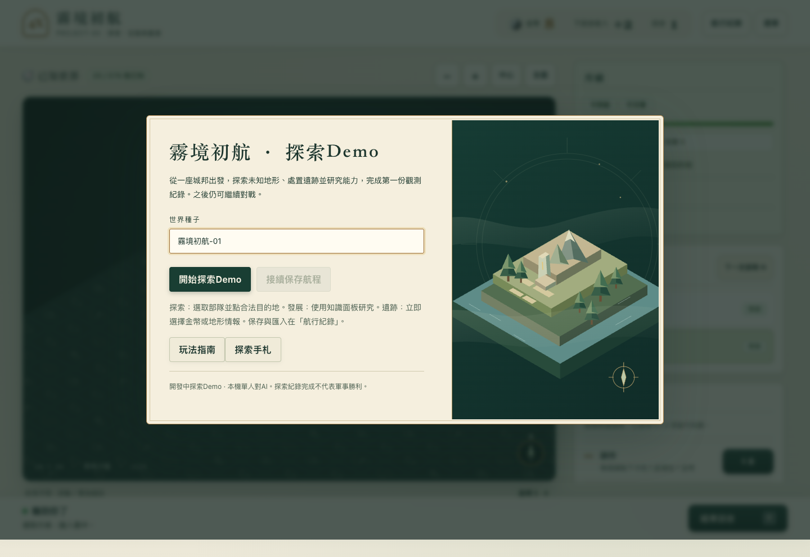
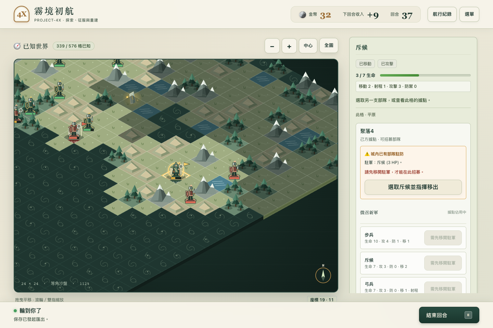
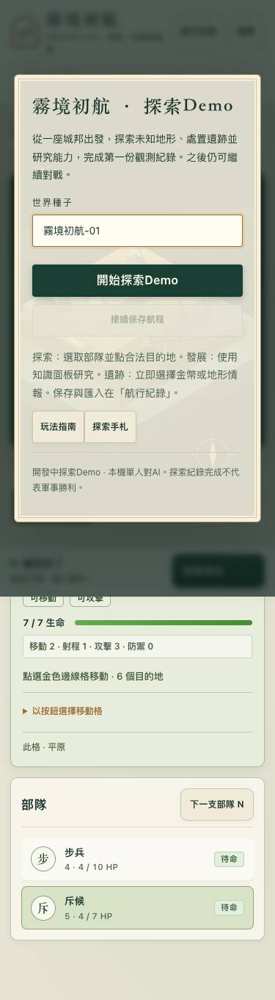

# Demo03-V01 前端增量交接

狀態 IMPLEMENTED＋本機TESTED_PASS；獨立code review APPROVE，PR待建立，不代表完整Demo03或Alpha。

## 已實作
沿用主創確認Mistbound Diorama 70/20/10、Canvas2D、Native DOM、D3手機分頁及相機。G1三兵改為站立原創微縮兵模，五地形palette集中管理，森林增加幾何變化、山丘增加刻線。主選單加入原創裝飾地景SVG及圖桌排版，手機主要操作全寬；手札與遺跡仍顯示真實合法資料。遺跡有440ms一次性transform/opacity動畫，reduce停用。無新框架或外部字體依賴。

新兵模不是新兵種；持盾步兵仍是原infantry，沒有新增盾衛能力。裝飾插畫不是實際地圖或世界真相，不是mock UI截圖，沒有新增Canon。

## 權威資料流

    GameState / applyCommand（不改）
                │
       GameSession → GameplayPort（不改）
                │合法Observation / legalActions
                ▼
       WorldMap → visual-registry → miniatures
          │                            │
          └─ 原onSelect callback    Canvas畫筆
                │
       原composition root → 原submitAction

原生Dialog/HUD仍接既有合法資料，只有CSS/token/SVG/動態變化。

- src/ui/visual-registry.ts：getTerrainVisual只讀visibility/terrain，unknown必回fog；getUnitVisual缺素材用unidentified，不假畫弓兵。metadata frozen，沒有能力/費用/命令。
- src/ui/miniatures.ts：paintMiniature(ctx,x,y,kind,own)只畫已提供兵種/關係，不查GameState/history/seed。
- src/ui/map.ts：站立頭部先命中合法可見單位，再拾取地格；unknown不建立命中目標。仍只回傳座標，不改state或自行dispatch。
- src/styles.css/public/art/menu-diorama.svg：純呈現。原創幾何MIT，來源/SHA在ASSET-REGISTRY。
- scripts/build-pwa.mjs：僅將該SVG登錄固定白名單；其他SVG/data仍拒絕，static-only cache/hash/waiting保留。

Frontend-Core v1沒有新增API。Unit/Terrain visual registry已用；通用Gameplay/Building/Civilization/Event registry尚未完成，不能用本切片冒稱內容引擎。

## 真實驗證與失敗
完整整合231/231；後續2個常駐縮放/碰撞邊界加入後fresh233/233（223原＋10新）、check/build、Browser11、Gameplay12（209/220）、Demo4、Fog、Save/Replay、PWA離線及A/B更新PASS。另4項真Chromium測試：桌機mouse/手機touch點頭選對單位，Save bytes不變；真Move觸發並ResolveRelic；正常440ms動畫實際完成、reduce無動畫。不是mouse替代touch。

保留全部FAIL：證據父目錄缺件（未跑玩法）；未登錄SVG被PWA拒絕；舊QA探針把局部translate當camera；QA scrollIntoView把手機觸點放在sticky header下。後者改為先恢復可見地圖，elementFromPoint仍嚴格要求Canvas，未改預期座標。相機探針與頭部命中均有RED→GREEN。raw logs只留private evidence，公開TEST-RESULTS有run IDs/exit/hash/限制。

沒有LSP，使用npm run check；沒有axe/真人/真機，不宣稱已驗。

## 真實比較

Demo02主選單：

Demo03候選：

相同既有戰鬥旅程的原／新呈現：

手機：

8張截圖均真Browser執行，viewport/實際圖片大小/狀態/SHA見SCREENSHOTS.json。手機是模擬touch；fullPage長圖不代表實體裝置尺寸。

## 重現與接手

    npm ci --ignore-scripts
    npx --no-install playwright install chromium
    node scripts/verify-demo02.mjs

此入口是既有玩法回歸，不等於Demo03完整完成。另啟npm start後：

    node scripts/visual-check.mjs

可用PROJECT4X_URL、PROJECT4X_EVIDENCE_DIR（新獨立目錄）及PROJECT4X_CHROMIUM_PATH。完成後停自己的server，不上傳raw world/trace。核心15檔與base逐bytes相同，詳SOURCE-BOUNDARY。下一步先review/PR；新兵/科技數值與ruleset仍待裁決，Demo02 Tag不覆寫。
